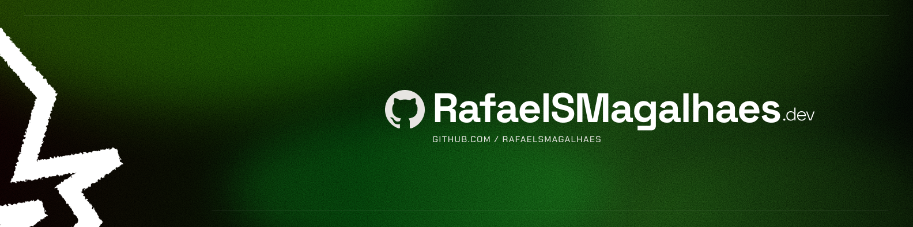

<div align="center">



<br/>


### Oi, eu sou o Rafael!


<br/>


[](https://github.com/RafaelSMagalhaes)
[](https://linkedin.com/in/SEU_LINKEDIN)
[](mailto:SEU_EMAIL)

</div>

<br/>


<h2 align="center">
  Sobre Mim 
</h2>

> "Eu não desistia até entender o porquê de cada coisa."

Sou estudante de Engenharia de Software na UniJorge e tenho interesse em desenvolvimento de software, análise de dados e inteligência artificial.

Minha curiosidade sempre me levou a explorar diferentes áreas. Ao longo do tempo, passei por interesses como economia, investimentos, futebol e design. Cada experiência acrescentou uma perspectiva diferente à maneira como observo problemas e busco soluções.

Foi na programação que encontrei uma forma de conectar essa curiosidade à prática: entender problemas, construir soluções e aprender continuamente.

Atualmente, estou desenvolvendo minha base técnica com Python, SQL e SQLite, aplicando o que estudo em projetos pessoais e buscando uma oportunidade de estágio para evoluir em um ambiente profissional.
<br/>

<h2 align="center">
  Stack
</h2>

<p align="center">
  
</p>

<p align="center">
  <sub>Python · SQL · SQLite · Git · GitHub · HTML · CSS · JavaScript · VS Code · Figma · Photoshop</sub>
</p>

<br/>

<h2 align="center">
  Atualmente
</h2>

| Área | Foco |
|---|---|
| Formação | Engenharia de Software — UniJorge |
| Desenvolvimento | Python, SQL e fundamentos de programação |
| Prática | Projetos pessoais e organização de código |
| Explorando | Inteligência Artificial e análise de dados |
| Objetivo | Primeira oportunidade profissional em tecnologia |
```python
class Rafael:
    curso      = "Engenharia de Software · UniJorge"
    cidade     = "Camaçari, BA 🇧🇷"
    foco       = ["Python", "SQL", "IA"]
    superpoder = "curiosidade que não desiste"

    def aprender(self):
        while not self.entendeu_o_porque:
            self.estudar()
            self.construir()
        return "próximo desafio"
```

<br/>

<h2 align="center">
  
  Metas
</h2>

- [x] Entrar na faculdade de Engenharia de Software
- [x] Descobrir na programação o meu caminho
- [ ] Concluir a graduação
- [ ] Publicar projetos com Python e SQL aqui no GitHub
- [ ] Conquistar a primeira oportunidade de estágio
- [ ] Aprofundar em Inteligência Artificial

<br/>

<h2 align="center">
  
  Projetos em destaque
</h2>

<div align="center">

<a href="https://github.com/RafaelSMagalhaes/NOME_DO_PROJETO_1">
  
</a>
<a href="https://github.com/RafaelSMagalhaes/NOME_DO_PROJETO_2">
  
</a>

</div>

<br/>

<h2 align="center">
  
  GitHub em números
</h2>

<div align="center">


</div>

<br/>

<details>
<summary><b>✨ Curiosidades sobre mim</b></summary>

<br/>

- 🧩 Gosto de desmontar problemas até entender cada peça
- ⚽ Futebol faz parte da minha história
- 🎨 Design e edição de vídeo me ensinaram a cuidar da apresentação
- 📈 Economia e investimentos despertaram meu lado analítico

</details>

<br/>

<div align="center">


</div>

<br/>

<h2 align="center">
  
  Vamos conversar?
</h2>

<p align="center">
  Aberto a estágios, projetos e boas conversas sobre tecnologia.
</p>

<p align="center">
  <a href="https://github.com/RafaelSMagalhaes"></a>
  &nbsp;
  <a href="https://linkedin.com/in/SEU_LINKEDIN"></a>
  &nbsp;
  <a href="mailto:SEU_EMAIL"></a>
</p>

<div align="center">


<sub>Feito com curiosidade e muito café ☕</sub>

</div>
